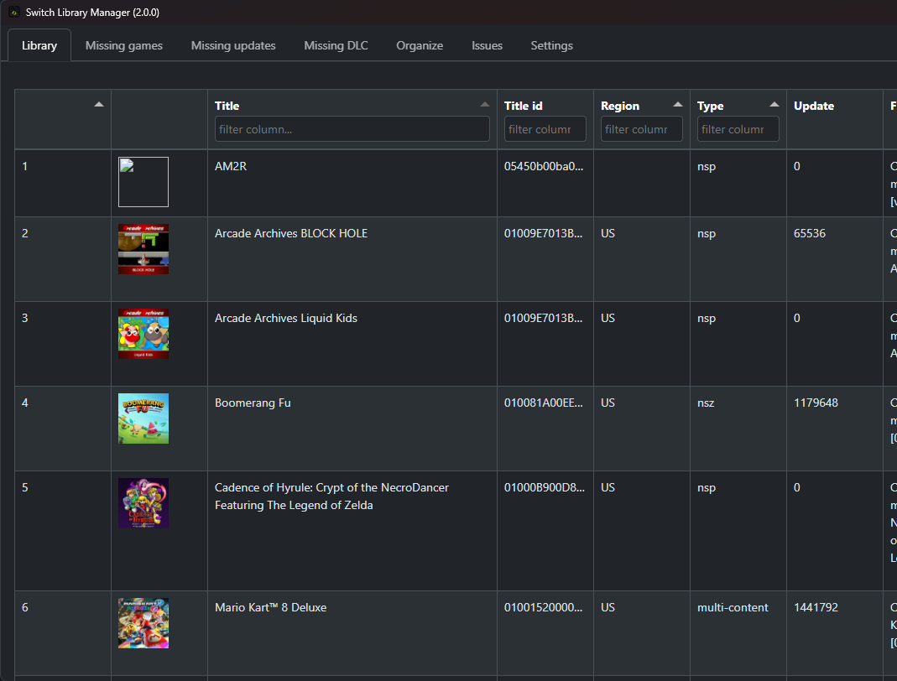
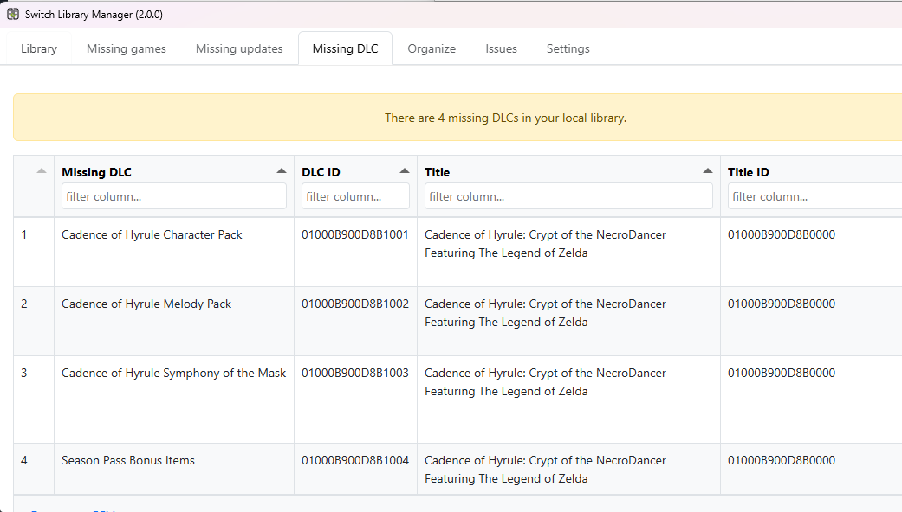
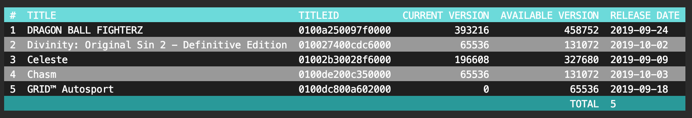

# Switch library manager

Fork of [Switch Library Manager](https://github.com/giwty/switch-library-manager) created by giwty with continued improvements and changes

Easily manage your switch game backups

## Features

### General

- Cross platform, works on Windows / Mac / Linux
- GUI and command line interfaces in the same executable
- All crypto operations implemented in Go, no external tools needed (the GUI uses the system web view, see [Usage](#usage))

### Scanning

- Scan your local switch backup library (NSP/NSZ/XCI/XCZ), including split files (`.00`, `.01`, ...)
- Scan additional folders alongside the main library folder
- Read titleId/version by decrypting NSP/NSZ/XCI/XCZ (requires prod.keys)
- If no prod.keys present, fallback to read titleId/version by parsing file name (example: `Super Mario Odyssey [0100000000010000][v0].nsp`).
- Handles multi-content files, where one NSP/XCI contains a base game, updates and/or DLC
- Reports skipped files (unsupported, duplicate, old, malformed or unrecognized)
- Title and version data is downloaded automatically and kept up to date

### Missing content

- Lists missing update files (for games and DLC)
- Lists missing DLCs
- Ignore lists for specific DLC and update title IDs

### Organization

- Automatically organize games per folder, with optional subfolders for updates and DLC
- Rename files and folders using [naming templates](docs/naming.md) (title name, title ID, version, region, type, DLC name, package contents, file size)
- Optionally move files from additional scan folders into the library
- Delete old update files (in case you have multiple update files for the same game, only the latest will remain)
- Delete empty folders

## Keys (optional)

Having a prod.keys file will allow you to ensure the files you have a correctly classified.
On Windows and Linux, the app will look for the "prod.keys" file in the app folder or under ${HOME}/.switch/
On macOS, it looks in `~/Library/Application Support/Switch Library Manager` or under ${HOME}/.switch/ (not beside the app).
You can also specify a custom location in [`settings.json`](docs/settings.md).

Note: Only the header_key, and the key_area_key_application_XX keys are required.

## Settings

The application creates a current `settings.json` on first launch. You can customize paths, scanning, organization, missing-content checks, and GUI behavior there. See the [complete settings reference](docs/settings.md) for the format, cache behavior, and migration instructions, and the [naming template guide](docs/naming.md) for file and folder naming options.

## Usage

### GUI keyboard shortcuts

- Press `Ctrl+R` to rescan the library or `Ctrl+Shift+R` to perform a hard rescan from any tab.
- On macOS, `Command+R` and `Command+Shift+R` are also supported; the corresponding `Ctrl` shortcuts continue to work.

### Windows

- Requires the Microsoft Edge WebView2 runtime, which is included in Windows 10 and 11
- Extract the zip file
- Double click the Exe file
- If you want to use command line mode, update `settings.json` with `"gui": {"enabled": false}`, or pass `-m console`
  - Open `cmd`
  - Run `switch-library-manager.exe`

### macOS

- Download the `darwin-arm64` zip for Apple Silicon (M1 or newer) or the `darwin-amd64` zip for Intel Macs
- Extract the zip file and move `switch-library-manager.app` to a folder of your choice, for example `Applications`
- The app is not signed or notarized by Apple, so macOS blocks it the first time it is opened. To allow it, either:
  - Try to open the app, then go to System Settings > Privacy & Security and click "Open Anyway", or
  - Open Terminal and run `xattr -dr com.apple.quarantine /path/to/switch-library-manager.app`
- If macOS reports that the app "is damaged", use the `xattr` command above
- If macOS reports that the app "can't be opened" on releases before beta10, run `chmod +x /path/to/switch-library-manager.app/Contents/MacOS/switch-library-manager`
- Double click the App file
- On macOS, `settings.json`, the database, and `slm.log` are stored in `~/Library/Application Support/Switch Library Manager`
- If you want to use command line mode, update `settings.json` with `"gui": {"enabled": false}`, or pass `-m console`
  - Open your Terminal
  - `cd` into the app bundle: `cd /path/to/switch-library-manager.app/Contents/MacOS`
  - Run `./switch-library-manager -m console`

### Linux

- The `linux-amd64-webkit40` archive is built on Ubuntu 22.04 and requires WebKitGTK 4.0. The `linux-amd64-webkit41` archive is built on Ubuntu 24.04 and requires WebKitGTK 4.1; it may also need newer system libraries than older distributions provide.
- Install the matching WebKitGTK runtime library and GTK 3. Ubuntu 22.04 example: `sudo apt install libwebkit2gtk-4.0-37`. Ubuntu 24.04 example: `sudo apt install libwebkit2gtk-4.1-0`. These packages bring in their runtime dependencies, including GTK 3.
- Extract the archive, open a terminal in its folder, and run `chmod +x switch-library-manager` followed by `./switch-library-manager`.
- The executable also runs console mode (`./switch-library-manager -m console`) and has the same WebKitGTK runtime requirement.

The release archives are named `switch-library-manager-v<VERSION>.linux-amd64-webkit40.tar.gz` and `switch-library-manager-v<VERSION>.linux-amd64-webkit41.tar.gz`; the suffix identifies the required WebKitGTK API version.

### Console parameters

NOTE: parameters are only usable in command line mode, except the parameter -m (mode) which will override `gui.enabled`.

| Name           | Flag | Value       | Description                                                                                        |
| -------------- | ---- | ----------- | -------------------------------------------------------------------------------------------------- |
| Mode           | -m   | console/gui | Which mode to start the application in, overrides **gui.enabled** in settings.json                 |
| NSP Folder     | -f   | _path_      | Path to the NSP folder, overrides **paths.library_folder** in settings.json                        |
| Recursive scan | -r   | true/false  | If recursive scan should be used for the NSP folder, overrides **scan.recursive** in settings.json |
| Export CSV     | -e   | _path_      | Folder to write missing updates, missing DLC and issues to in CSV format (see below)               |

The CSV files are named `slm_missing_updates.<date>.csv`, `slm_missing_dlc.<date>.csv`, and `slm_issues.<date>.csv`, where `<date>` is `YYYY-MM-DD`. The folder is created if it does not exist.

## Building

### Source layout

- `src/frontend` contains the embedded vanilla JavaScript frontend and generated Wails bindings.
- `src/backend/app` contains Wails GUI orchestration and frontend DTOs.
- `src/backend/consoleapp` contains the command-line workflow.
- `src/backend/db`, `fileio`, `process`, `settings`, and `switchfs` contain reusable domain logic.
- `src/assets/icons` contains source application icons; Wails build assets are generated under `src/build`.

### Windows, macOS, or Linux

- Install and set up Go (1.25 or newer) and the Wails CLI: `go install github.com/wailsapp/wails/v2/cmd/wails@v2.15.0`
- Clone the repo: `git clone https://github.com/trembon/switch-library-manager.git`
- From the repository root, prepare the Wails build assets:
  - PowerShell: `pwsh -File .\scripts\prepare-wails-build-assets.ps1`
  - Bash/Git Bash: `bash scripts/prepare-wails-build-assets.sh`
- Move into the Go/Wails project: `cd switch-library-manager/src`
- Generate the Wails bindings: `wails generate module`
- Build the application: `wails build`
- Binaries will be available under `src/build/bin`

#### Linux WebKitGTK variants

From the `src` directory, install the build dependencies matching the selected version. For WebKitGTK 4.0, use `libgtk-3-dev` and `libwebkit2gtk-4.0-dev`, then run `wails generate module` and `wails build -platform linux/amd64 -webview2 embed`. For WebKitGTK 4.1, use `libgtk-3-dev` and `libwebkit2gtk-4.1-dev`, then run `wails generate module -tags webkit2_41` and `wails build -platform linux/amd64 -webview2 embed -tags webkit2_41`.

### Visual Studio Code debugging

- Install the Go and Wails extensions and ensure `wails` is available on `PATH`.
- Open the repository root in VS Code and press `F5`.
- Select `Wails: Debug Switch Library Manager`. The launch configuration builds with debug symbols and starts the combined executable in GUI mode.

The same executable still supports the console workflow. Run `src/build/bin/switch-library-manager.exe -m console` on Windows, or `./src/build/bin/switch-library-manager -m console` on macOS/Linux.

## Thanks

This program relies on [blawar's titledb](https://github.com/blawar/titledb), to get the latest titles and versions. The `titles.json` and `versions.json` files are generated from titledb with [blawar's NUT](https://github.com/blawar/nut) every six hours and published to this repository's [`data` release](https://github.com/trembon/switch-library-manager/releases/tag/data), which the app downloads by default.
